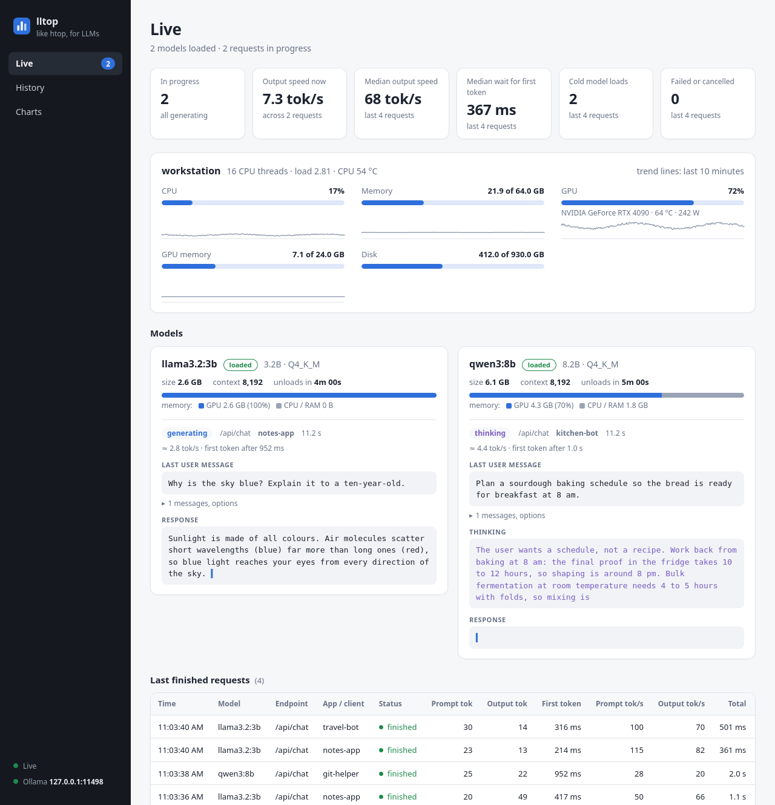
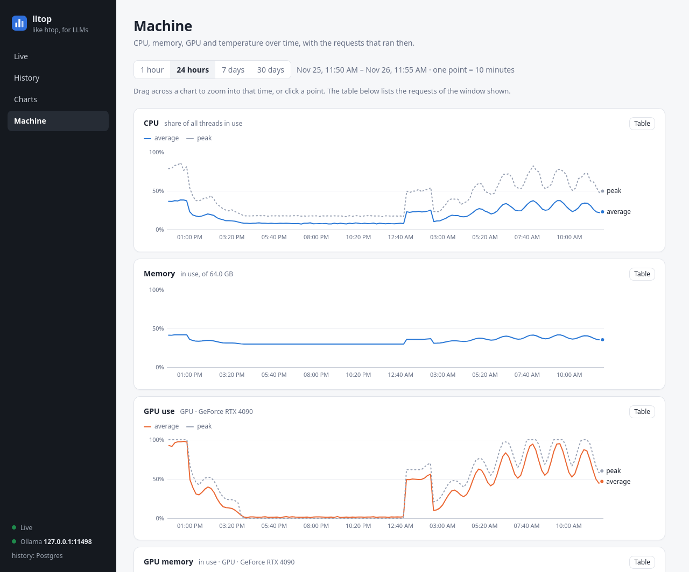

# lltop

*Like `htop`, but for LLMs.*

[](https://github.com/mrkbkr-17/lltop/actions/workflows/tests.yml)
[](https://github.com/mrkbkr-17/lltop/releases/latest)
[](LICENSE)




A live monitoring dashboard for [Ollama](https://ollama.com). Put it in front of Ollama
and watch every request as it happens: which model, who sent it, the prompt, the thinking
and the response appearing token by token, then the final speed and timing numbers.

It is a **streaming reverse proxy**. Clients talk to lltop exactly as they would
talk to Ollama; every request is forwarded unchanged and every response chunk is passed
straight back. A copy of each chunk goes to the dashboard.

Useful when Ollama is slow (CPU-only machines, big models) and you want to know what it is
doing right now, which app is using it, and how fast it really is.

> Status: milestone 2. The last 50 requests survive restarts (a JSON file); with
> PostgreSQL configured, every request is kept, searchable in the History tab and charted
> in the Charts tab, and the machine's readings are kept for the Machine tab.

## What it shows

- **Headline numbers**: requests in progress and how many still wait for their first
  token, the output speed right now, and, over the last 50 requests, the median speed,
  the median wait for the first token, cold model loads and failures.
- **The machine** (Linux): CPU, memory and disk as meters, CPU temperature and load, and
  for each NVIDIA GPU its use, memory, temperature and power draw (through `nvidia-smi`),
  each with a trend line of the last 10 minutes. Read from `/proc` and `/sys`, no extra
  package. These are the meters of the machine lltop runs on: when Ollama is on another
  machine, turn the card off with `--no-machine`, or show that machine's meters too
  (see [Several machines](#several-machines)).
- **One card per model**: loaded or not, size, how much of it sits in GPU memory vs
  system RAM, context length, and a countdown to when Ollama unloads it (from `/api/ps`,
  polled every 3 s).
- **Requests in progress**, inside their model's card: endpoint, client address, elapsed
  time, phase (reading prompt / thinking / generating), the prompt (plus the whole
  conversation, tools and options), and the thinking and response text as it streams,
  with a live tokens/s estimate.
- **History tab** (with PostgreSQL): every request ever made, newest first, filtered by
  model, status, endpoint and client, with full-text search in prompts and responses.
- **Charts tab** (with PostgreSQL), for the last 24 hours or 7, 30 or 90 days, all models
  or one: requests, tokens, median speed, median wait for the first token, failures and
  cold loads as headline numbers; requests over time stacked by model; output speed and
  wait for the first token over time, one line per model (the wait includes time spent
  in Ollama's queue); and which clients use the models. Each chart has a table view.
- **Machine tab** (with PostgreSQL): the machine's CPU, memory, GPU use, GPU memory and
  temperature over the last hour, 24 hours, 7 or 30 days, with the requests started in
  each period underneath. Drag across any chart to zoom into that span, or click one
  point; you can go down to one point per minute, and "Zoom out" walks back. Below the
  charts is a table of the requests that were running in the window shown, so a spike can
  be traced to what caused it. Each chart has a table view.

  
- **The last 50 finished requests** (saved to a file, so a restart keeps them): prompt and output tokens, time to first token,
  prompt and output tokens/s, total time, cold or warm model load, status (finished,
  error, cancelled). Click a row for the full prompt, response and Ollama's raw stats.

## Quick start

Requires [uv](https://docs.astral.sh/uv/) and a running Ollama.

```sh
git clone https://github.com/mrkbkr-17/lltop.git
cd lltop
uv run lltop
```

Point a client at port **11435** instead of 11434:

```sh
curl http://127.0.0.1:11435/api/chat -d '{
  "model": "llama3.2",
  "messages": [{"role": "user", "content": "Why is the sky blue?"}]
}'
```

and open the dashboard at <http://127.0.0.1:11435/lltop/>.

### Options

| Flag | Environment | Default | |
|---|---|---|---|
| `--host` | `LLTOP_HOST` | `127.0.0.1` | Address to listen on. `0.0.0.0` exposes it to your network. |
| `--port` | `LLTOP_PORT` | `11435` | |
| `--upstream` | `LLTOP_UPSTREAM` | `http://127.0.0.1:11434` | Where Ollama is. |
| `--poll` | `LLTOP_POLL` | `3` | Seconds between `/api/ps` polls. |
| `--history` | `LLTOP_HISTORY` | `~/.local/state/lltop/history.json` | Where the last 50 requests are saved. `--no-history` keeps them in memory only. |
| `--pg-dsn` | `LLTOP_PG_DSN` | off | PostgreSQL for the full history, e.g. `postgresql://lltop@localhost:5432/lltop`. Password in `~/.pgpass`, not here. |
| `--app-headers` | `LLTOP_APP_HEADERS` | see below | Request headers that name the calling app. |
| `--no-machine` | `LLTOP_MACHINE=off` | on | Leave out the machine card (CPU, memory, disk, temperature, GPU). |
| `--machines` | `LLTOP_MACHINES` | none | Other machines to show beside this one: `NAME=URL` or just `URL`, comma-separated. See [Several machines](#several-machines). |
| `--meters-only` | `LLTOP_METERS_ONLY=on` | off | Serve only this machine's meters, for another lltop's `--machines`. No proxy, no dashboard. |
| `--log-level` | `LLTOP_LOG_LEVEL` | `info` | |

### Docker

```sh
docker build -t lltop .
docker run --rm -p 127.0.0.1:11435:11435 -v lltop-data:/data \
  --add-host=host.docker.internal:host-gateway lltop
```

The image listens on all interfaces inside the container and expects Ollama at
`http://host.docker.internal:11434` (set `LLTOP_UPSTREAM` otherwise, e.g.
`http://ollama:11434` when both run on the same Docker network).

### Naming the calling app

lltop labels each request with the app that sent it, from the first of these request
headers it finds (only that one value is kept; other headers are never stored):

- `X-Lltop-App: my-script` - any caller can set it; Ollama ignores it.
- `x-litellm-user_api_key_alias` (then `..._team_alias`, `..._end_user_id`) - sent by a
  [LiteLLM](https://github.com/BerriAI/litellm) gateway, so requests show the virtual
  key's name instead of the gateway's address. In LiteLLM's `config.yaml`, scoped to your
  local model groups so key details aren't sent to cloud providers:

  ```yaml
  litellm_settings:
    add_user_information_to_llm_headers: true
    model_group_settings:
      forward_client_headers_to_llm_api: ["fast", "smart"]   # your Ollama model groups
  ```

Without a name, the client address is shown.

### History in PostgreSQL (optional)

Every finished request becomes a row in table `requests` (created automatically): the
prompt or messages, tools, options, thinking, response, client, and the stats as columns.
It holds every prompt, so give lltop its own database and role that nobody else can
connect to:

```sql
CREATE ROLE lltop LOGIN PASSWORD '…';
CREATE DATABASE lltop OWNER lltop;
REVOKE CONNECT ON DATABASE lltop FROM PUBLIC;
```

Then put the password in `~/.pgpass` (`host:5432:lltop:lltop:password`, mode 0600) and
start lltop with `LLTOP_PG_DSN=postgresql://lltop@host:5432/lltop`. If PostgreSQL is
unreachable, lltop keeps working: rows wait in a queue (10,000) and are written when it is
back. On the first start it also copies the requests from the history file.

The machine's readings go to a second table, `machine_minutes`: one row per machine and minute with
the averages and the peaks (CPU, memory, temperature, each GPU), numbers only. That is
about 1,440 small rows a day per machine; nothing deletes them yet. The Machine tab's history starts
when lltop first runs with this version.

### Several machines

One dashboard can show the meters of more than one machine: a card per machine on the
Live page, and a machine picker on the Machine tab.

On each other machine, run lltop with only its meters (no proxy, no dashboard, nothing
stored), listening on the network:

```sh
lltop --meters-only --host 0.0.0.0
```

On the machine with the dashboard, name them:

```sh
lltop --machines "gpu-box=http://192.168.1.20:11435, nas=http://192.168.1.30:11435"
```

lltop fetches each machine's last reading every `--poll` seconds (a plain GET of
`/lltop/api/meters`). A machine that stops answering keeps its card, greyed out and marked
"not answering"; its readings resume by themselves. With PostgreSQL, every machine gets
its own rows in `machine_minutes`.

- `/lltop/api/meters` has no login: anyone who can reach the port can read the host name
  and its CPU, memory, disk, temperature and GPU numbers. Nothing else is served in
  `--meters-only` mode. Keep it on a network you trust.
- A whole lltop (one that fronts an Ollama on that machine) answers `/lltop/api/meters`
  too, so it can be listed in `--machines` as it is.
- Only the meters are collected. Requests appear on the dashboard of the lltop they go
  through: the request list and the "Requests started" chart are always this lltop's own.

## Run as a service (systemd)

[`contrib/systemd/lltop.service`](contrib/systemd/lltop.service) runs lltop as a systemd
user service that starts at boot and restarts if it crashes:

```sh
uv sync --no-dev
systemctl --user link "$PWD/contrib/systemd/lltop.service"
systemctl --user enable --now lltop.service
journalctl --user -fu lltop
```

The unit expects the clone at `~/lltop`; edit `ExecStart` otherwise. Settings go in
`~/.config/lltop/env` (for example `LLTOP_HOST=0.0.0.0`). To keep it running while you are
logged out: `sudo loginctl enable-linger $USER`.

## Privacy

The dashboard shows every prompt and response in full, to anyone who can open the page.
Nothing leaves the machine. The last 50 requests, prompts and responses included, are
saved in the history file, readable by its owner only (mode 0600; `--no-history` to
turn it off). By default lltop only listens on `127.0.0.1` for that reason. Only use `--host 0.0.0.0` on a network you
trust: there is no login.

## How it works

```
  client ──HTTP──▶ lltop :11435 ──HTTP──▶ Ollama :11434
    ▲                 │   ▲                        │
    └──── chunks ◀────┤   └──────── chunks ◀───────┘
                      │ copy of each chunk
                      ▼
                    Tap ──events──▶ Hub ──WebSocket──▶ dashboard (/lltop/)
                                     ▲
                       /api/ps poller┘
```

- **Proxy** (`proxy.py`): forwards every method and path with its headers and body. The
  response is relayed chunk by chunk as it arrives; nothing is buffered. `POST`
  requests to `/api/chat`, `/api/generate` and `/v1/chat/completions` (streaming or
  not) are also handed to a tap, after the caller has been sent each chunk.
- **Tap** (`tap.py`): reads the request (model, messages or prompt, tools, options) and
  the response (Ollama's NDJSON, OpenAI-style Server-Sent Events, or a single JSON
  body), and emits `started`, `token`, `finished`, `error` and `cancelled` events.
- **Stats** (`stats.py`): tokens/s for prompt and output from Ollama's own durations,
  time to first token measured by the proxy, and a cold load when Ollama's
  `load_duration` is a second or more (or, when Ollama gives no stats, when `/api/ps`
  didn't list the model as the request started). `/v1/chat/completions` reports no
  durations, so its output speed is estimated from chunk timing (marked `*`).
- **Store** (`store.py`, optional): writes each finished request, and each minute of
  machine readings, to PostgreSQL from a background queue and answers the History, Charts
  and Machine tabs' queries.
- **Machine** (`machine.py`): reads the meters every `--poll` seconds. On a system
  without `/proc` (macOS, Windows) it switches itself off and the card is not shown.
- **Hub** (`hub.py`): the in-memory state (loaded models, requests in progress, last 50,
  the last 200 machine readings)
  and the fan-out to browsers. `history.py` saves the last 50 to a JSON file (at most
  every 2 s, and on shutdown, when requests still running are kept as `interrupted`). Each browser gets its own bounded queue; one that falls
  behind is disconnected and reconnects to a fresh snapshot.

### Design rules

- **Fail open.** Inspection can never break a request: tap methods catch their own
  errors and the proxy wraps every call to them again. If the dashboard code fails, the
  request still reaches Ollama and returns normally; the dashboard marks it as an error.
- **No added latency.** Chunks go to the caller before anything else looks at them, and
  publishing an event never waits for a browser.
- **Cancellation passes through.** When a caller hangs up, lltop closes its
  connection to Ollama, so Ollama stops generating, also while still waiting for the
  first token.
- **Transparent.** Everything outside `/lltop/` belongs to Ollama, including `/`.

### Endpoints of its own

| Path | |
|---|---|
| `/lltop/` | The dashboard |
| `/lltop/ws` | WebSocket: a `snapshot` on connect, then every event |
| `/lltop/api/state` | The snapshot as JSON |
| `/lltop/api/history` | PostgreSQL history: `?model=&status=&endpoint=&client=&q=&before=&limit=`, and `&running_from=&running_to=` (epoch seconds) for the requests running in a time window |
| `/lltop/api/history/{id}` | One request in full |
| `/lltop/api/history-facets` | Models, endpoints and statuses with counts |
| `/lltop/api/machine` | Machine readings for the Machine tab: `?from=&to=` (epoch seconds), `&machine=` (a name; default: this machine); the points get coarser as the window grows (1 minute up to 1 day) |
| `/lltop/api/meters` | This machine's last reading (numbers and the host name), for another lltop's `--machines` |
| `/lltop/api/stats` | Aggregates for the Charts tab: `?range=24h\|7d\|30d\|90d&model=&tz=` |

## Development

```sh
uv run pytest
```

The PostgreSQL tests need a throwaway database (they drop and recreate its `requests`
table) and are skipped otherwise:

```sh
LLTOP_TEST_PG_DSN=postgresql://lltop@localhost:5432/lltop_test uv run pytest
```

The tests use a fake Ollama: stream reassembly and parsing, the stats math, byte-for-byte
forwarding, fail-open behaviour, and, on real sockets, that chunks are passed on before
Ollama has sent the next one and that a caller hanging up closes the connection to
Ollama.

## Roadmap

- Retention settings (delete requests and machine readings older than N days).
- A React dashboard.
- Running as the default endpoint in front of Ollama for other gateways.

## License

MIT, see [LICENSE](LICENSE).
